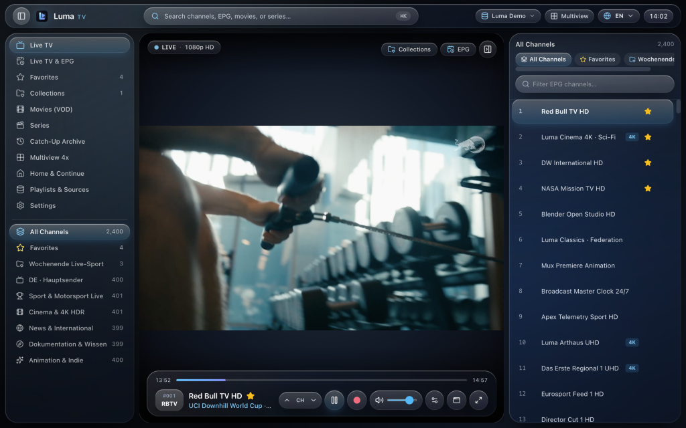
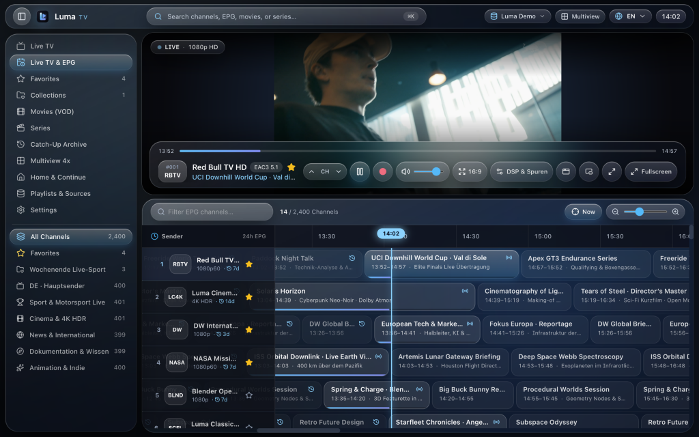
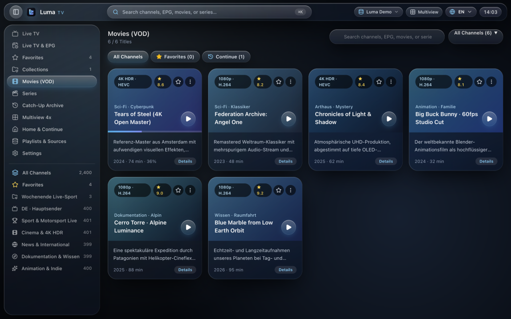
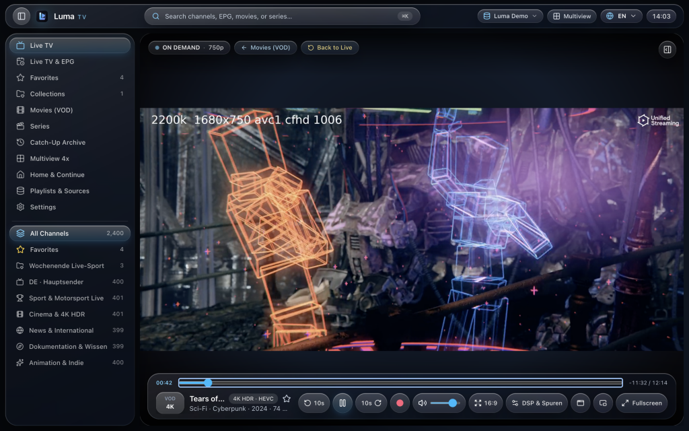
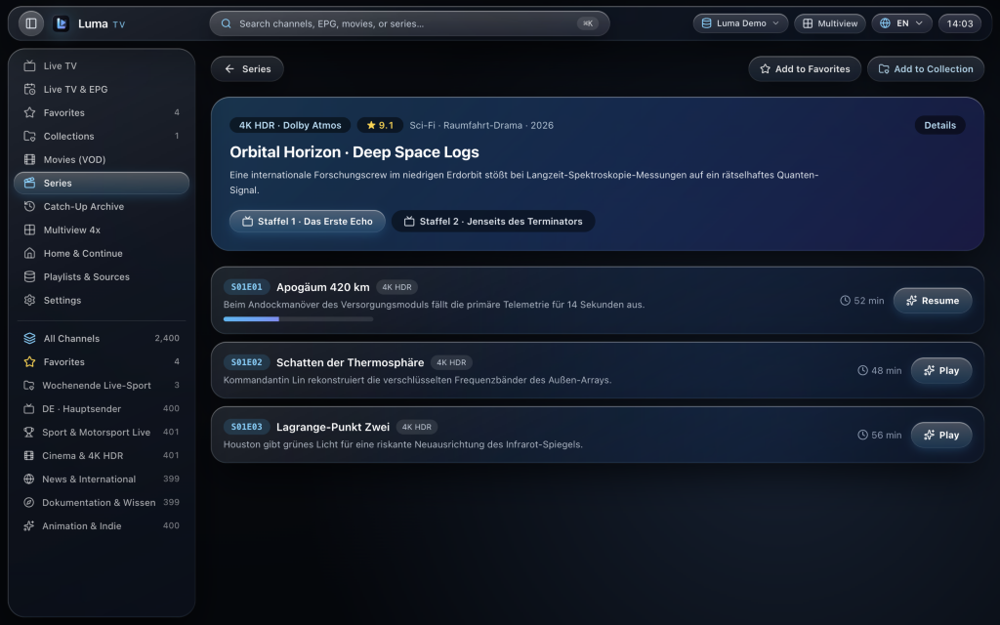
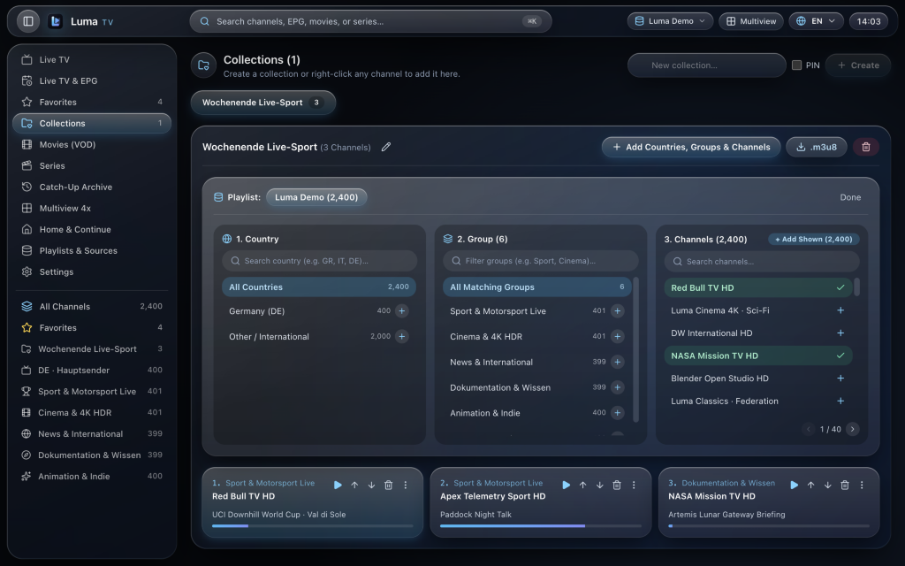
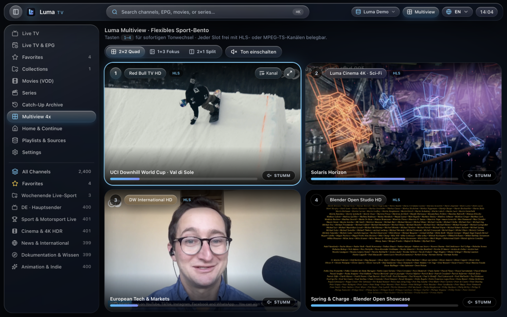
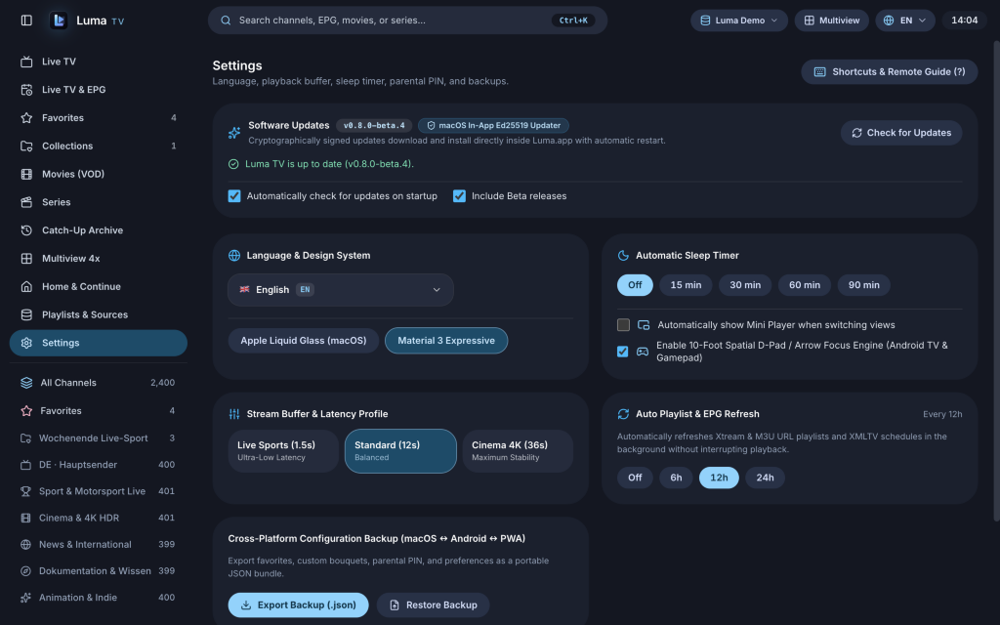
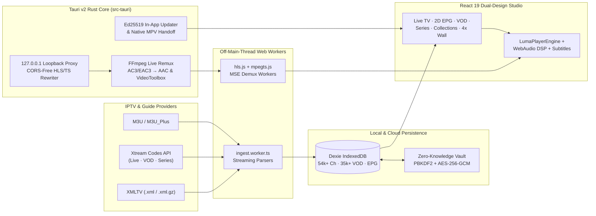

<div align="center">


# Luma TV

**High-Luminance Cross-Platform Live TV, VOD Movies, Series & XMLTV Streaming Studio**

[](https://github.com/petrosvassiliou/luma-tv/releases)
[](https://v2.tauri.app/)
[](https://react.dev/)
[](https://www.typescriptlang.org/)
[](https://www.rust-lang.org/)
[](#downloads)

**M3U / M3U_Plus · Xtream Codes API · XMLTV (`.xml` / `.xml.gz`) · In-Window FFmpeg Remux · Zero-Knowledge Cloud Sync**

[Download Latest Release](https://github.com/petrosvassiliou/luma-tv/releases/latest) · [Visual Tour](#-visual-tour) · [Key Features](#-key-features) · [Shortcuts](#-keyboard-remote--gamepad-shortcuts) · [Build From Source](#-local-development--native-builds)

</div>

---



**Luma TV** (`app.lumatv.client`) is a modern, hardware-accelerated IPTV, VOD Movie, and Series client built with **Tauri v2 (Rust)**, **React 19**, and **Web Workers**. It handles **54,000+ Live Channels**, **35,000+ VOD Movies**, and **25,000+ Series** at 60fps while adapting natively to each operating system's visual language: **Apple Liquid Glass** on macOS and **Google Material 3 Expressive** on Android, Android TV, GoogleOS / Chromebooks, and the Web.

---

## Downloads

Grab prebuilt binaries from [**GitHub Releases**](https://github.com/petrosvassiliou/luma-tv/releases/latest):

| Platform | Package | Architecture & Signing | Auto-Update Mechanism |
| :--- | :--- | :--- | :--- |
| **macOS** *(12.0+)* | `Luma_<version>_universal.dmg` | Universal Binary (`Apple Silicon arm64` + `Intel x86_64`) | **In-App Ed25519 Signed Updater** *(downloads, verifies & restarts inside Luma)* |
| **Android, Android TV & Chromebook** *(Android 8.0+)* | `Luma_<version>_universal.apk` | Universal **4-ABI** (`arm64-v8a`, `armeabi-v7a`, `x86_64`, `x86`) · APK Signature **v2 + v3** | **Google Play Protect–Compatible** *(zero `REQUEST_INSTALL_PACKAGES` permissions)* |
| **ChromeOS / Web PWA** | Self-hosted (`Vite 8` + `Firebase`) | Standalone PWA with `window-controls-overlay` & offline Service Worker | Instant web deployment + Service Worker cache refresh |

> [!TIP]
> **macOS First Launch (Unsigned Gatekeeper Note):** If macOS displays an unverified developer prompt on first launch after dragging **Luma.app** to `/Applications`, run once in Terminal:
> ```bash
> xattr -cr /Applications/Luma.app
> ```
> All subsequent releases install seamlessly from inside **Settings → Software Updates** using cryptographic **Ed25519** signature verification.

---

## Visual Tour

### 1. Live TV Cinema Stage & Virtualized Channel Drawer (`Apple Liquid Glass`)
Clean edge-to-edge broadcast stage with container-responsive `@container` glass HUD, quick Collection switcher, live EPG progress, and a 60fps virtualized channel drawer.


---

### 2. Split Live Stage & 60fps Virtualized 2D EPG Grid
Simultaneous live playback and multi-day 2D Electronic Program Guide with real-time playhead tracking, zoomable timeline scale, instant channel filtering, and Catch-Up archive indicators.



---

### 3. Movies (VOD) Library & 4K On-Demand Cinema HUD
Browse up to **35,000+ VOD Movies** with instant search, category/playlist filtering, `Continue Watching` progress bars, Favorites, and Collections — paired with a dedicated **On-Demand Player HUD** featuring `VOD / 4K` badges, `← Movies (VOD)` quick return, external `.SRT`/`.VTT`/`.ASS` subtitles, and in-window FFmpeg Dolby audio remuxing.

| Movies (VOD) Catalog Hub | On-Demand 4K Cinema Player HUD |
| :---: | :---: |
|  |  |

---

### 4. Xtream Series Hub & 3-Column Collections Builder
Lazy-hydrated **Series detail view** with season tabs, episode resume tracking, and one-click Favorites/Collections — alongside the **3-Column Bouquet Builder (`Playlist → Country → Group → Channels`)** for curating custom cross-playlist bouquets in seconds.

| Xtream Series Seasons & Episodes | 3-Column Country, Group & Channel Builder |
| :---: | :---: |
|  |  |

---

### 5. 4-Stream Multiview Wall & Google Material 3 Expressive Mode
Monitor up to four simultaneous live broadcasts in **2×2 Quad**, **1+3 Focus**, or **2×1 Split** bento layouts (`1–4` keys switch active audio instantly), or switch the entire studio to **Google Material 3 Expressive** with integrated software update controls and automatic background playlist refresh.

| 4-Stream Multiview Broadcast Wall | Settings & Auto-Updater (`Material 3 Expressive`) |
| :---: | :---: |
|  |  |

---

## Key Features

### Dual-Platform Design System
- **Apple Liquid Glass (`data-design="liquid-glass"`):** Default on macOS & iPadOS — multi-layered translucent glass cards, specular hairline borders, native macOS traffic-light titlebar integration, and responsive `@container` transport controls.
- **Google Material 3 Expressive (`data-design="m3-expressive"`):** Default on Android, Android TV, Googlebook/Chromebook, and Linux/Windows Web — high-contrast tonal hierarchy, 10-foot living-room legibility, focus rings, and freeform multi-window resizing (`resizeableActivity="true"`).

### Playback Engine, In-Window Native FFmpeg Remux & Studio Audio DSP
- **Dual Web Worker MSE Engine:** Powered by `hls.js` and `mpegts.js` with adaptive bitrate (ABR) selection, multi-audio track switching, embedded caption tracks, and three latency profiles (*Live Sports 1.5s*, *Standard 12s*, *Cinema 4K 36s*).
- **Embedded `127.0.0.1` Rust Stream Proxy:** Native Tauri loopback HTTP/HLS/MPEG-TS proxy (`reqwest`) eliminates CORS blocks, follows upstream redirects with custom IPTV User-Agents, and rewrites relative/absolute `.m3u8` segment & AES-128 key URIs on the fly.
- **In-Window Native FFmpeg Remux & Dolby Audio Transcode (macOS):** Plays `.mkv` / `.avi` containers and **Dolby AC-3 / E-AC-3 / DTS** surround streams directly inside the Luma window:
  - **Zero-CPU Remux (`?transcode=remux`):** Copies original H.264/HEVC video bitstreams untouched (`-c:v copy`) while transcoding multi-channel Dolby/DTS audio to 192 kbps stereo AAC (`-c:a aac`) inside a streaming MPEG-TS pipe.
  - **Hardware VideoToolbox Fallback (`?transcode=hw`):** Automatically escalates unsupported video codecs (HEVC 10-bit / MPEG-2 / VC-1) to Apple Silicon `h264_videotoolbox` fragmented MP4 — with automatic child-process cleanup on channel zapping.
- **External Hardware Player Handoff:** One-click **MPV** native process launch on macOS plus **VLC / MPV** deep-link handoff.
- **WebAudio Broadcast DSP:** Real-time audio processing chain offering *Linear Direct*, *Vocal Boost*, *Cinema Bass*, *Night DRC* (dynamic range compression for late-night viewing), and clean pre-amp gain up to **160%**.
- **Live DVR Recording, Catch-Up & Picture-in-Picture:** Record live stream clips (`MediaRecorder` MP4/WebM), replay aired broadcasts via **Catch-Up / Timeshift** (*Xtream `/timeshift/`*, *M3U_Plus `catchup-source`*, *Flussonic*, *Shift*), and pop streams into native or in-app **Picture-in-Picture (PiP)**.
- **4-Stream Multiview (`4x`):** Watch four concurrent HLS or MPEG-TS streams in `2×2 Quad`, `1+3 Focus`, or `2×1 Split` layouts with single-keystroke audio routing.

### External & Online Subtitles
- **Local `.SRT`, `.VTT` & `.ASS`/`.SSA` Support:** Load external subtitles from disk or **drag and drop** subtitle files directly onto the player stage, automatically converting `.srt` and `.ass`/`.ssa` dialogues into clean WebVTT cues.
- **Remote URL & OpenSubtitles Lookup:** Fetch remote subtitle URLs (CORS-free via the native Rust bridge) or open a pre-filled **OpenSubtitles** search for the current movie or episode.
- **Live Sync Offset (`±0.5s`):** Nudge subtitle timing forward or backward in real time with a dedicated high-contrast cinema caption overlay.

### High-Scale Catalog Ingestion & Ranked Search (`Cmd+K` / `Ctrl+K`)
- **Off-Main-Thread Web Worker Parsers:** Ingest massive **M3U / M3U_Plus** playlists, **Xtream Codes API** catalogs (*Live*, *VOD Movies*, *Series*), and **XMLTV** schedules (`.xml` and `.xml.gz` via streaming `DecompressionStream`) into IndexedDB (`Dexie.js`) without blocking the UI thread.
- **Normalized Multi-Token Search:** Instant `Cmd+K` / `Ctrl+K` command bar with Unicode NFKD + IPTV superscript normalization (`ᴴᴰ` → `HD`, `ᵁᴴᴰ` → `UHD`, `⁴ᴷ` → `4K`, `ᶠᴴᴰ` → `FHD`) across 54,000+ channels, EPG programs, VOD movies, and series.
- **Automatic Background Playlist & EPG Refresh:** Silent `6h` / `12h` / `24h` background refresh keeps dynamic Xtream & M3U URLs and XMLTV program schedules current without interrupting playback.

### Collections, Favorites & Channel Studio
- **3-Column Bouquet Builder:** Drill down through **Playlist → Country → Group → Channels** to bulk-add whole countries, sports/cinema groups, or individual streams across multiple providers into unified Collections.
- **Cross-Media Favorites & PIN Lock:** Star Live Channels, VOD Movies, and Xtream Series; lock sensitive collections behind a **4-digit Parental PIN**; reorder channels; and export any collection as a standard `.m3u8` file.
- **Channel Studio:** Bulk toggle visibility by country or group, rename channels, customize channel numbers, and inspect EPG `tvg-id` bindings.

### Auto-Updater, Zero-Knowledge Cloud Sync & Localization
- **Cryptographic Auto-Updater:**
  - **macOS:** Built-in `tauri-plugin-updater` verifies Ed25519 signatures, streams progress in-app, replaces `Luma.app`, and restarts automatically.
  - **Android / Android TV / Chromebook:** Checks GitHub Releases against a consistent 4096-bit release keystore (**APK Signature Scheme v2 + v3**) and hands off APK downloads cleanly via HTTPS to pass **Google Play Protect** without invasive sideload permissions.
- **Zero-Knowledge Encrypted Sync & Portable Backups:** End-to-end client-side `PBKDF2-SHA256` (150,000 iterations) + `AES-256-GCM` Firebase sync vault, plus one-click `.json` configuration export/import across macOS, Android, Chromebook, and Web.
- **Live 6-Language UI:** Instant dropdown switcher in the titlebar and Settings for **Deutsch (`DE`)**, **English (`EN`)**, **Italiano (`IT`)**, **Français (`FR`)**, **Español (`ES`)**, and **Ελληνικά (`GR`)**.
- **10-Foot TV Spatial Focus & Gamepad Engine:** 2D raycast directional focus engine for Android TV D-Pad remotes, desktop keyboards, numeric channel zapping (`0–9`), and W3C Gamepads.

---

## Keyboard, Remote & Gamepad Shortcuts

Press `?` anywhere in Luma TV to toggle the on-screen Shortcut & Remote OSD.

| Key / Input | Action |
| :--- | :--- |
| `Cmd + K` / `Ctrl + K` / `/` | Open Global Command Search (Channels, EPG, Movies & Series) |
| `Space` / `K` | Play / Pause active stream |
| `F` | Toggle Fullscreen cinema stage |
| `M` | Mute / Unmute audio |
| `Arrow Up` / `Arrow Down` *(or `P+` / `P-`)* | Zap to Previous / Next channel (or navigate 10-foot spatial focus) |
| `Arrow Left` / `Arrow Right` | Seek `-10s` / `+10s` in VOD, Series & Catch-Up (or spatial focus) |
| `0` – `9` | Direct numeric channel zapping OSD |
| `1` – `4` *(in Multiview)* | Solo audio for Multiview slot `1`–`4` |
| `G` / `E` | Jump to Virtualized 2D EPG Grid |
| `C` | Toggle Live TV Channel & Collection Drawer |
| `?` | Open Keyboard & TV Remote Shortcut Guide |
| `Escape` / `Back` | Close modal / drawer or exit Fullscreen |

---

## Architecture Overview



### Core Repository Layout

```text
luma-tv/
├── src/
│   ├── components/
│   │   ├── command/          # Cmd+K normalized multi-token search bar
│   │   ├── common/           # LanguageDropdown, AppUpdateBanner, Shortcut OSD
│   │   ├── epg/              # 60fps 2D VirtualizedEpgGrid
│   │   ├── layout/           # CustomTitlebar (traffic-light overlay) & Sidebar
│   │   ├── player/           # PlayerStage HUD, Multiview, PiP & BroadcastSynthCanvas
│   │   └── views/            # LiveTV, Movies (VOD), Series, Collections, Studio & Settings
│   ├── db/                   # Dexie.js IndexedDB schema (sources, channels, vod, series, epg)
│   ├── engine/               # LumaPlayerEngine, WebAudio DSP, DVR recorder, Tauri bridge
│   ├── i18n/                 # 6-language live dictionary (DE, EN, IT, FR, ES, GR)
│   ├── services/             # Playlist refresh, subtitle converter, spatial nav, Cloud Sync, updater
│   └── workers/              # Off-main-thread M3U_Plus, Xtream & XMLTV (.gz) parsers
├── src-tauri/                # Rust Tauri v2 desktop/mobile core, loopback HLS/FFmpeg proxy & updater
├── functions/                # Optional Firebase Cloud Functions CORS/HLS stream proxy (Web PWA)
├── docs/screenshots/         # High-resolution UI screenshots across Liquid Glass & M3 Expressive
└── .github/workflows/        # Automated macOS Universal (.dmg + Ed25519) & 4-ABI Android (.apk) CI
```

---

## Local Development & Native Builds

### Prerequisites
- **Node.js** `22+` and `npm`
- **Rust** stable toolchain (`rustup`) for native Tauri v2 macOS / Android builds
- *(Optional on macOS)* **FFmpeg** (`brew install ffmpeg`) for in-window `.mkv` / Dolby `AC-3`/`E-AC-3` remuxing and **MPV** (`brew install mpv`) for external player handoff

### Quick Start (Web / PWA Dev Server)

```bash
# 1. Install dependencies (root + optional Cloud Functions)
./scripts/setup-local.sh   # or: npm install

# 2. Start Vite dev server at http://localhost:5173
npm run dev
```

### Native macOS Build (`Tauri v2`)

```bash
# Launch native macOS Liquid Glass dev window with embedded Rust proxy
npm run tauri:dev

# Build production macOS .app and .dmg bundle
npm run tauri:build
```

### Native Android, Android TV & Chromebook Build (`Tauri v2 Mobile`)

```bash
# Initialize Android project (first time) & build APK
npm run tauri:android:init
npm run tauri:android:build
```

### Quality & Verification Suite

```bash
npm run lint                                       # oxlint (0 warnings, 0 errors)
npm test                                           # Vitest unit tests (parsers, search, catch-up, EPG)
npm run build                                      # TypeScript strict build + Vite production bundle
cargo check --manifest-path src-tauri/Cargo.toml   # Verify Rust Tauri core & loopback proxy
```

---

## Privacy & Content Disclaimer

**Luma TV** does **not** bundle, host, sell, or distribute any proprietary television channels, movies, playlists, or media streams. The built-in demo mode uses exclusively open-source / public reference test streams (such as Blender Open Movie studio masters) for UI evaluation. Users are solely responsible for supplying their own authorized M3U, Xtream Codes, or XMLTV sources.
