<div align="center">

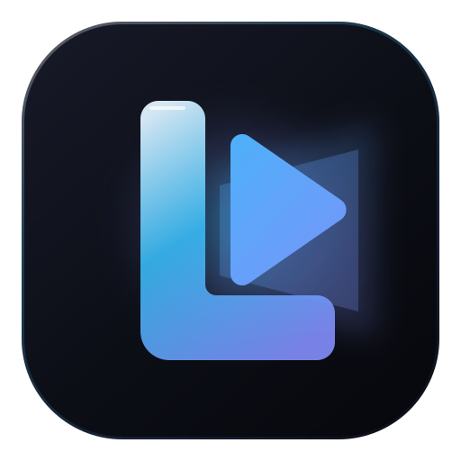

# Luma TV 1.0

**High-Luminance Cross-Platform Live TV, VOD Movies, Series & XMLTV Streaming Player**

[](https://github.com/petrosvassiliou/luma-tv/releases)
[](https://v2.tauri.app/)
[](https://react.dev/)
[](https://www.typescriptlang.org/)
[](https://www.rust-lang.org/)
[](#downloads)

**M3U / M3U_Plus · Xtream Codes API · XMLTV (`.xml` / `.xml.gz`) · Chromecast & Apple TV Casting · Zero-Knowledge Cloud Sync**

[Download Latest Release](https://github.com/petrosvassiliou/luma-tv/releases) · [macOS Screenshots](#macos-edition--apple-liquid-glass) · [Android & Googlebook Screenshots](#android-android-tv--googlebook-edition--material-3-expressive) · [Key Features](#key-features) · [Build From Source](#local-development--native-builds)

</div>

---

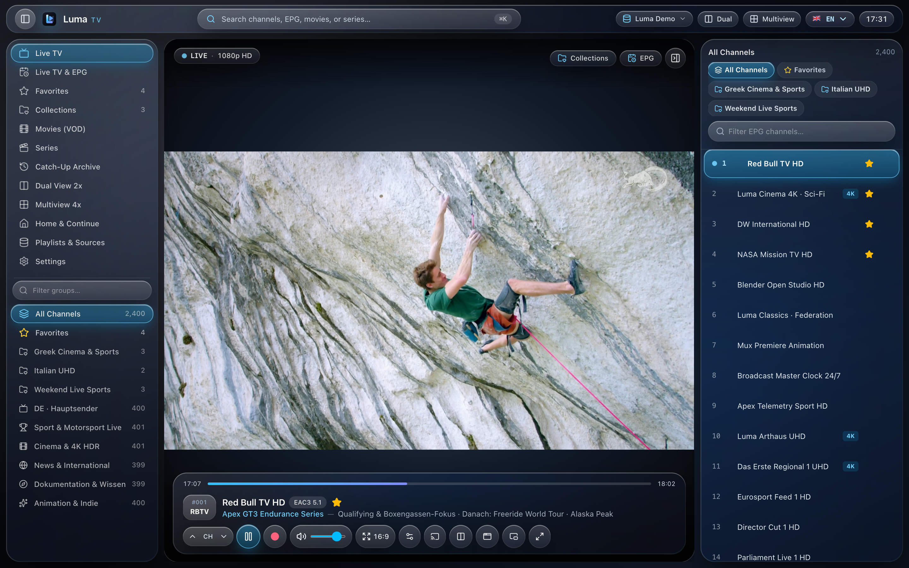

**Luma TV** (`app.lumatv.client`) is a fast, open-source, hardware-accelerated IPTV, VOD Movie, and Series studio built with **Tauri v2 (Rust)**, **React 19**, and **Web Workers**. It handles **54,000+ Live Channels**, **35,000+ VOD Movies**, and **25,000+ Series** at 60fps while adapting natively to each operating system's design language:
- **macOS (`Apple Silicon` & `Intel`):** Native **Apple Liquid Glass** (`data-design="liquid-glass"`), macOS traffic-light titlebar overlay, native **Apple TV AirPlay 2** wireless video handoff, in-window FFmpeg Dolby `AC-3`/`E-AC-3` remuxing, and hardware `MPV` handoff.
- **Android, Android TV & Googlebook / Chromebook:** Native **Google Material 3 Expressive** (`data-design="m3-expressive"`), automatic Wi-Fi **Chromecast / Google TV** discovery (`MediaRouter` + mDNS), 10-foot D-Pad spatial focus navigation, and freeform resizable ChromeOS windows.
- **Zero-Knowledge Encrypted Cloud Sync:** Incremental 3-way **Firebase Cloud Sync** (`PBKDF2-SHA256` + `AES-256-GCM`) keeps your playlists, Live/VOD/Series favorites, custom collections, watch progress, and startup channel seamlessly synchronized across all devices without duplicating playlists or exposing credentials.

---

## Downloads

Grab prebuilt binaries from [**GitHub Releases**](https://github.com/petrosvassiliou/luma-tv/releases):

| Platform | Package | Architecture & Signing | Auto-Update Mechanism |
| :--- | :--- | :--- | :--- |
| **macOS** *(13.0+)* | `Luma_<version>_universal.dmg` | Universal Binary (`Apple Silicon arm64` + `Intel x86_64`) | **In-App Ed25519 Signed Updater** *(downloads, verifies & restarts inside Luma)* |
| **Android, Android TV & Googlebook** *(Android 8.0+)* | `Luma-TV-Android-Universal.apk` | Universal **4-ABI** (`arm64-v8a`, `armeabi-v7a`, `x86_64`, `x86`) · APK Signature **v1 + v2 + v3** | **Google Play Protect–Compatible** *(verified Android System Installer, zero risky sideload permissions)* |
| **ChromeOS / Web PWA** | Self-hosted (`Vite 8` + `Firebase`) | Standalone PWA with `window-controls-overlay` & offline Service Worker | Instant web deployment + Service Worker cache refresh |

> [!TIP]
> **macOS First Launch (Unsigned Gatekeeper Note):** If macOS displays an unverified developer prompt on first launch after dragging **Luma.app** to `/Applications`, run once in Terminal:
> ```bash
> xattr -cr /Applications/Luma.app
> ```
> All subsequent releases install with one click inside **Settings → Software Updates** using cryptographic **Ed25519** signature verification.

---

## macOS Edition — Apple Liquid Glass

High-resolution (`2880 × 1800` Retina) captures of the native macOS Tauri v2 client (`data-design="liquid-glass"`):

### 1. Live TV Cinema Stage & Wrapped Collection Switcher
Edge-to-edge broadcast stage with specular translucent `.lg-pane` glass surfaces, tactile active states, wrapped multi-row Collection pills (zero horizontal clipping), live EPG progress bar, and a 60fps virtualized channel drawer.


### 2. Split Live Stage & 60fps Virtualized 2D EPG Grid
Simultaneous live playback and multi-day 2D Electronic Program Guide with real-time playhead tracking, zoomable timeline scale, program inspector, reminders, and one-click Catch-Up / Re-Live archive playback.

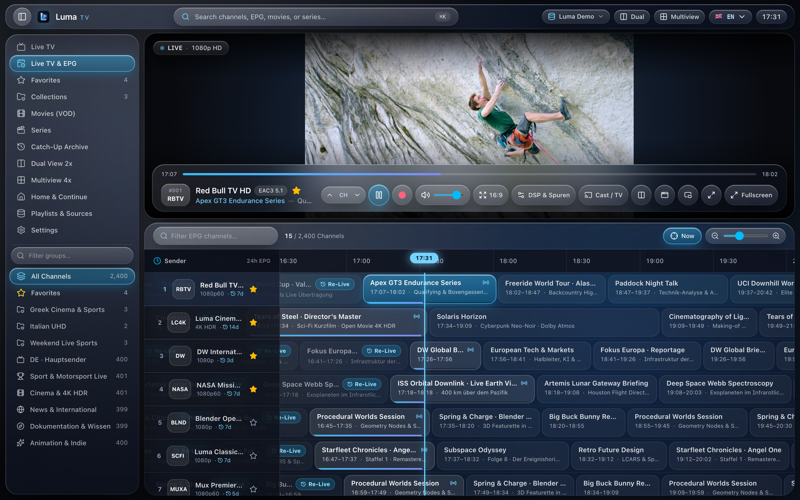

### 3. Dual View (`2x` Side-by-Side & Stacked)
Watch two live broadcasts simultaneously with draggable split ratios (`25%–75%`), instant audio slot switching (`1` / `2` or click), slot swap (`S`), and dedicated Favorites & Collection channel pickers.

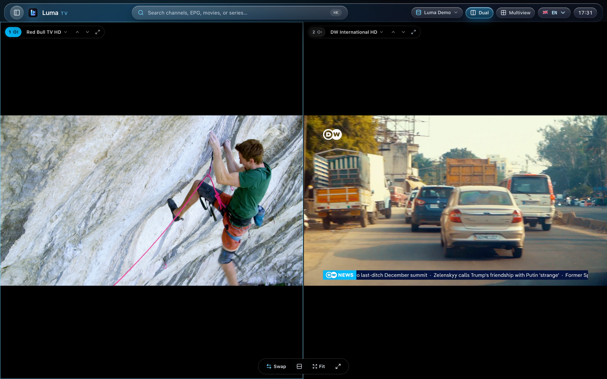

### 4. 4K Movies (VOD) Hub & 3-Column Collections Builder
Browse **35,000+ VOD Movies** with instant search, category filtering, and `Continue Watching` resume bars — alongside the **3-Column Bouquet Builder (`Playlist → Country → Group → Channels`)** for curating cross-playlist collections in seconds.

| macOS Movies (VOD) Library | macOS 3-Column Collections Builder |
| :---: | :---: |
|  | 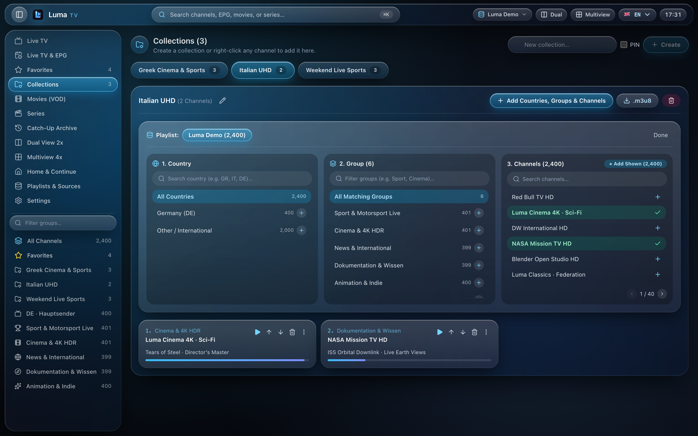 |

---

## Android, Android TV & Googlebook Edition — Material 3 Expressive

High-resolution (`2880 × 1800`) captures of the Android, Android TV, and Googlebook / Chromebook client (`data-design="m3-expressive"`):

### 1. Material 3 Live TV Stage & Automatic Wi-Fi Cast / AirPlay Discovery
Tonal stadium pills, high-contrast 10-foot focus rings, and native automatic Wi-Fi discovery of **Chromecast / Google TV** (`MediaRouter` + `CastContext`) and **Apple TV** (`NsdManager` + mDNS) directly inside the player — without opening external Android share sheets.

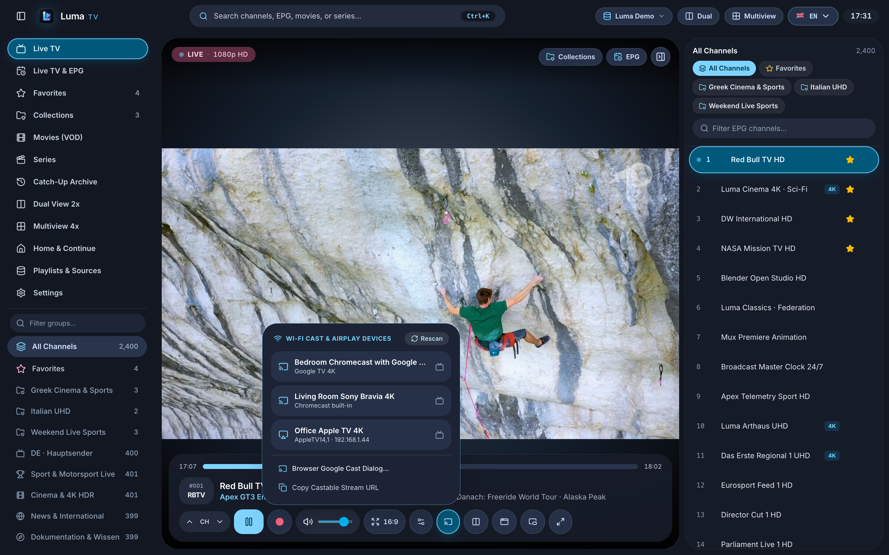

### 2. 10-Foot 2D EPG Grid & Xtream Series Hub
Living-room-legible 2D EPG timeline and lazy-hydrated **Xtream Series** browser with season tabs, episode progress tracking, and automatic `Next Episode` playback.

| Android / Googlebook 2D EPG Grid | Android / Googlebook Xtream Series Hub |
| :---: | :---: |
| 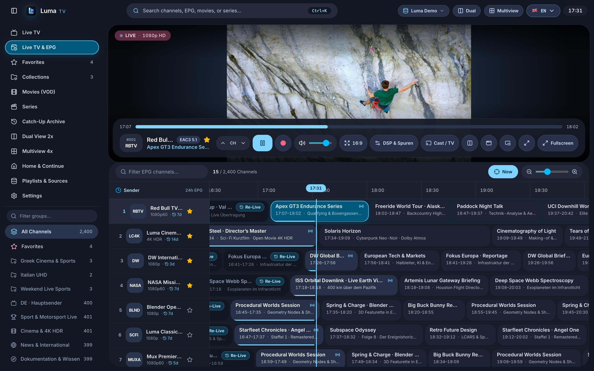 | 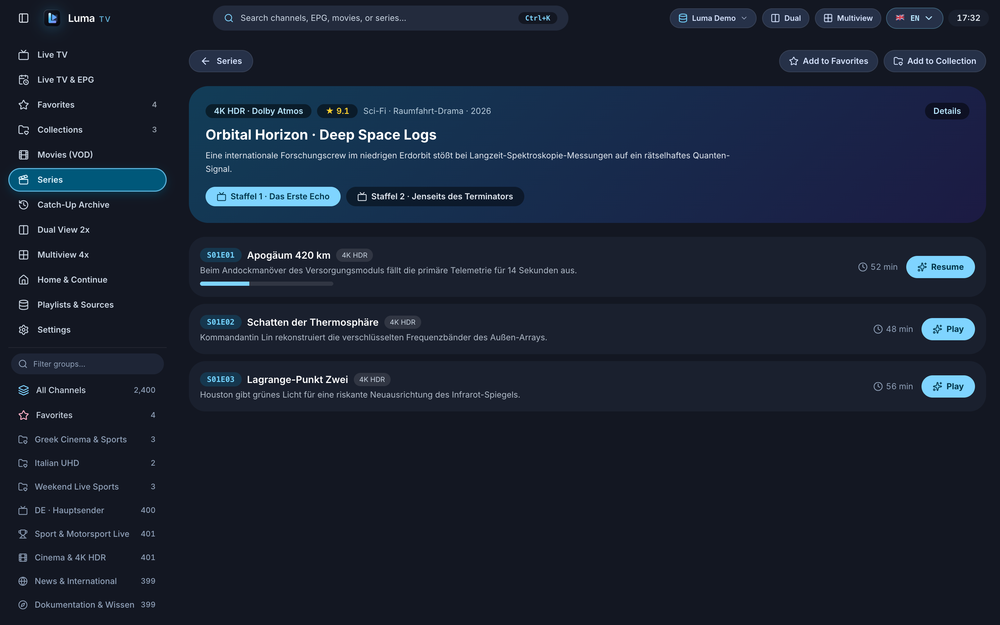 |

### 3. 4-Stream Multiview Wall (`4x`) & Zero-Knowledge Cloud Sync Settings
Monitor up to four live streams in **2×2 Quad**, **1+3 Focus**, or **2×1 Split** layouts — and synchronize playlists, favorites, collections, and your **Startup Channel** across devices via AES-256-GCM **Firebase Cloud Sync**.

| 4-Stream Multiview Broadcast Wall (`Material 3`) | Zero-Knowledge Cloud Sync, Startup Channel & Updater |
| :---: | :---: |
| 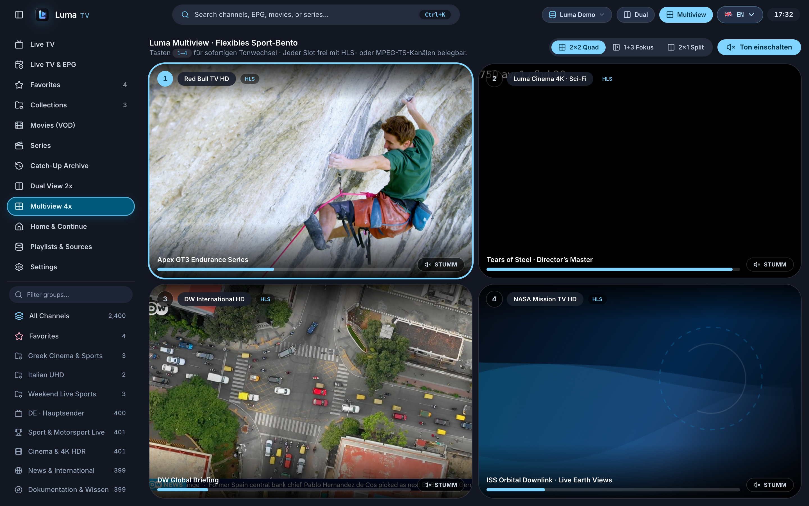 | 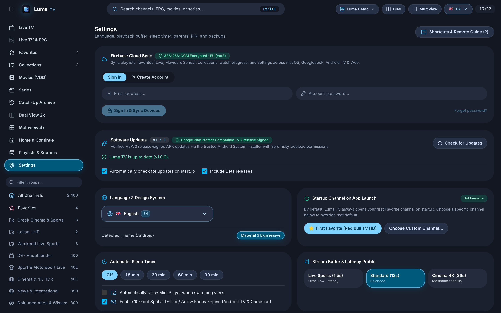 |

---

## Key Features

### Dual-Platform Native Design System
- **Apple Liquid Glass (`data-design="liquid-glass"`):** Multi-layered translucent glass cards, specular hairline borders, native macOS traffic-light titlebar clearance, portal-rendered unclipped menus, and tactile press feedback.
- **Google Material 3 Expressive (`data-design="m3-expressive"`):** Tonal surface hierarchy, stadium/squircle pills, 10-foot TV legibility, high-contrast D-Pad `:focus-visible` outlines, and ChromeOS ARCVM freeform window resizing (`resizeableActivity="true"`).

### Native Chromecast & Apple TV AirPlay 2 Streaming
- **Android, Android TV & Googlebook:** Built-in official Google Cast Framework (`play-services-cast-framework` + `androidx.mediarouter`) + `NsdManager` multicast discovery automatically scans your Wi-Fi for Chromecast, Google TV, Android TV, and AirPlay receivers and casts HLS/VOD streams directly via `RemoteMediaClient`.
- **macOS:** Dedicated pre-warmed `AVFoundation` AirPlay 2 media bridge invokes macOS's native wireless Apple TV target picker synchronously on click, backed by a native Rust mDNS (`224.0.0.251:5353`) + CastV2 TLS (`port 8009`) + AirPlay HTTP (`port 7000`) LAN engine.
- **Automatic Stream Adaptation:** Automatically converts raw Xtream MPEG-TS live URLs (`.ts`) to castable `.m3u8` HLS streams for hardware TV receivers.

### Zero-Knowledge Incremental Cloud Sync (v3)
- **End-to-End Client-Side Encryption:** Derives a deterministic per-account 256-bit key via `PBKDF2-SHA256` (150,000 iterations) + `AES-256-GCM` before anything touches Firestore (`eur3` EU region). Playlist URLs and Xtream passwords are never stored in cleartext.
- **Smart First-Time Sync Diffing:** Automatically detects factory-default installations (cleanly adopting your cloud vault without uploading demo items) vs. already-configured devices (diffing and merging local + cloud playlists, favorites, collections, and settings without data loss).
- **Zero Duplicate Playlists & Orphaned-ID Self-Healing:** Normalizes and compares M3U/Xtream server URLs, credentials, query parameters, and settings; consolidates duplicate playlists in IndexedDB in-place; embeds portable `channelSnapshots` for instant `0ms` cross-device rendering; and self-heals shifted or legacy channel IDs.
- **True 3-Way + Tombstone Incremental Sync:** Real-time Firestore `onSnapshot` listener propagates additions, edits, and deletions across devices while skipping redundant writes via canonical content digests.

### Playback Engine, In-Window FFmpeg Remux & Studio Audio DSP
- **Dual Web Worker MSE Engine:** Powered by `hls.js` and `mpegts.js` with adaptive bitrate (ABR) selection, multi-audio & subtitle track switching, and three buffer profiles (*Live Sports 1.5s*, *Standard 12s*, *Cinema 4K 36s*).
- **Zero-CORS Native Rust Bridge & `127.0.0.1` Stream Proxy:** Fetches M3U, Xtream JSON, and XMLTV catalogs directly through Rust `reqwest` over IPC and rewrites HLS `.m3u8` manifests/keys via an embedded local loopback proxy.
- **In-Window FFmpeg Remux & Dolby Audio Transcode (macOS):** Copies H.264/HEVC video bitstreams untouched (`-c:v copy`) while transcoding Dolby `AC-3`/`E-AC-3`/DTS surround audio to AAC — or escalates unsupported codecs to Apple Silicon `h264_videotoolbox`.
- **WebAudio Broadcast DSP:** Real-time *Linear Direct*, *Vocal Boost (+5.5 dB @ 2.5 kHz)*, *Cinema Bass*, *Night DRC* compressor, and clean pre-amp boost up to **160%**.
- **Dual View (`2x`), Multiview (`4x`), PiP, DVR & Catch-Up:** Side-by-side Dual View, 4-stream Multiview wall, detachable in-app Picture-in-Picture, live `MediaRecorder` clip recording, and Catch-Up archive playback (*Xtream `/timeshift/`*, *M3U_Plus `catchup-source`*, *Flussonic*, *Shift*).
- **Smart Startup Channel:** Automatically launches into your **First Favorite** channel by default, with an optional searchable **Custom Default Startup Channel** override in Settings or via right-click context menu.

### High-Scale Catalog Search, Collections & 6-Language UI
- **Normalized Multi-Token Search (`Cmd+K` / `Ctrl+K`):** Searches 54,000+ channels, VOD movies, and series in milliseconds with Unicode NFKD + IPTV superscript normalization (`ᴴᴰ` → `HD`, `ᵁᴴᴰ` → `UHD`, `⁴ᴷ` → `4K`).
- **3-Column Bouquet Builder & Parental PIN:** Curate cross-provider Collections (`Playlist → Country → Group → Channels`), lock groups/collections behind a 4-digit PIN, and export collections as `.m3u8`.
- **Live 6-Language Dictionary:** Instant switching between **Deutsch (`DE`)**, **English (`EN`)**, **Italiano (`IT`)**, **Français (`FR`)**, **Español (`ES`)**, and **Ελληνικά (`GR`)**.

---

## Keyboard, Remote & Gamepad Shortcuts

Press `?` anywhere in Luma TV to open the on-screen Shortcut & TV Remote Guide.

| Key / Input | Action |
| :--- | :--- |
| `Cmd + K` / `Ctrl + K` | Open Global Command Search (Channels, EPG, Movies & Series) |
| `Space` | Play / Pause active stream |
| `F` | Toggle Fullscreen cinema stage |
| `D` | Toggle Dual View (`2x` side-by-side / stacked) |
| `S` *(in Dual View)* | Swap Left & Right Dual View streams |
| `1` – `2` *(Dual)* / `1` – `4` *(Multiview)* | Switch active audio slot |
| `ChannelUp` / `ChannelDown` *(or `Alt + Up/Down`)* | Zap to Previous / Next channel |
| `0` – `9` | Direct numeric channel zapping OSD |
| `?` | Open Keyboard, D-Pad Remote & Gamepad Guide |
| `Escape` / `Back` | Close any open menu/modal or exit Fullscreen |

---

## Architecture Overview

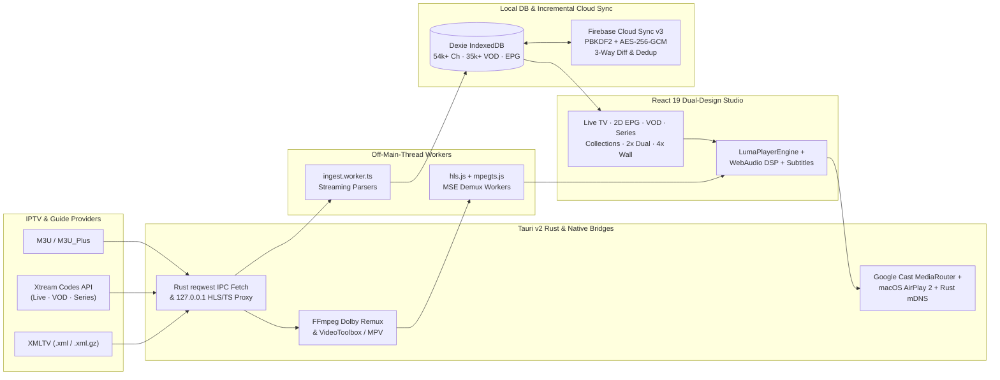

---

## Local Development & Native Builds

### Prerequisites
- **Node.js** `22+` (`24` recommended) and `npm`
- **Rust** stable toolchain (`rustup`) for native Tauri v2 desktop & mobile builds
- *(Optional on macOS)* **FFmpeg** (`brew install ffmpeg`) for in-window Dolby `AC-3`/`E-AC-3` remuxing and **MPV** (`brew install mpv`) for external player handoff

### Quick Start (Web / PWA Dev Server)

```bash
./scripts/setup-local.sh   # or: npm install
npm run dev                # http://localhost:5173
```

### Native macOS & Android / Googlebook Builds

```bash
# macOS Universal (.app / .dmg)
npm run tauri:dev
npm run tauri:build

# Android, Android TV & Googlebook (.apk)
npm run tauri:android:init
npm run tauri:android:build
```

### Verification & Smoke Test Suite

```bash
npm run lint                                       # oxlint (0 warnings, 0 errors)
npm test                                           # 42 Vitest UI smoke, sync & crypto tests
npm run build                                      # TypeScript strict build + Vite bundle
cargo test --manifest-path src-tauri/Cargo.toml    # 7 Rust proxy, CastV2 & mDNS unit tests
```

---

## Privacy & Content Disclaimer

**Luma TV** is strictly a media player and playlist organizer. It does **not** bundle, host, sell, or provide any proprietary television channels, movies, playlists, or subscriptions. Built-in demo mode uses exclusively open public reference streams (such as Blender Open Movie studio masters) for UI evaluation. Users must supply their own authorized M3U, Xtream Codes, or XMLTV sources.
